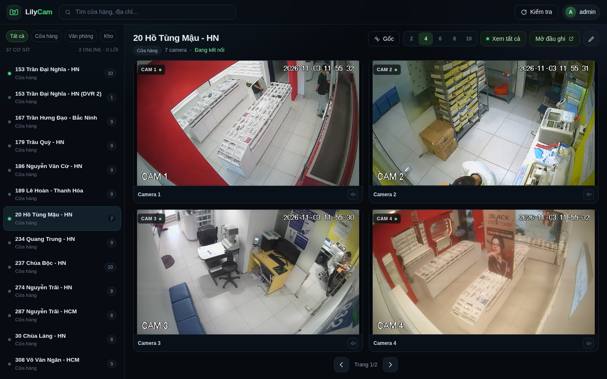
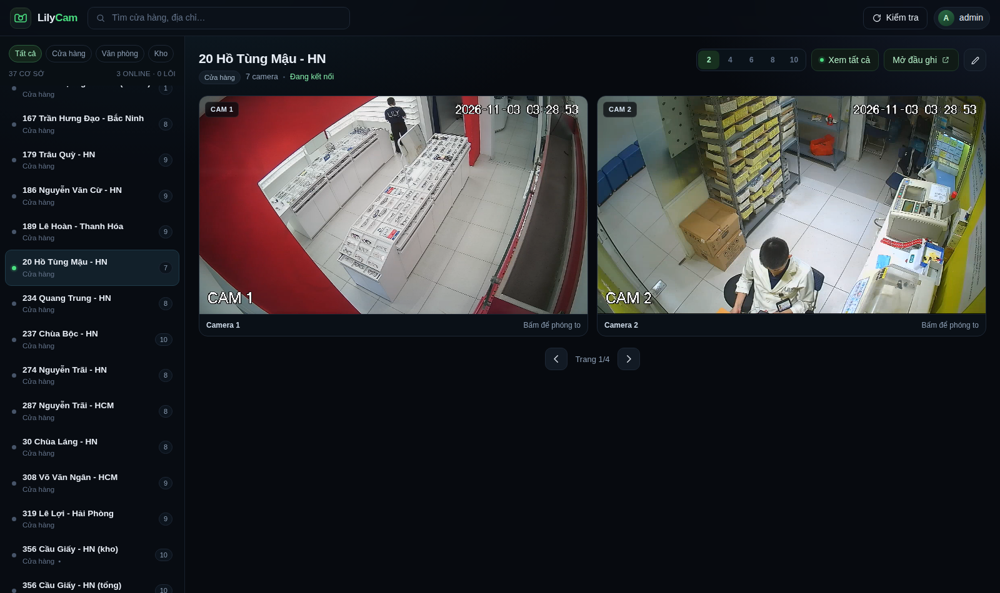
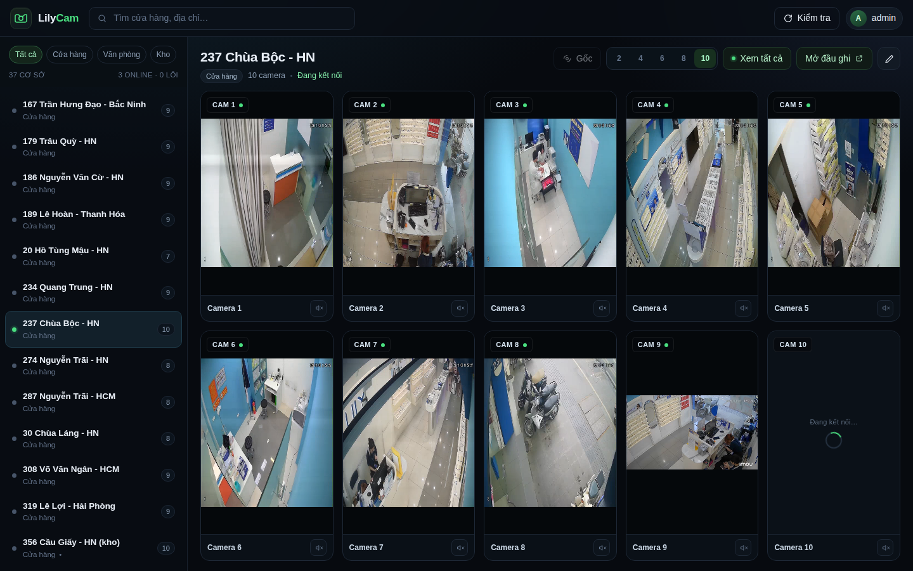
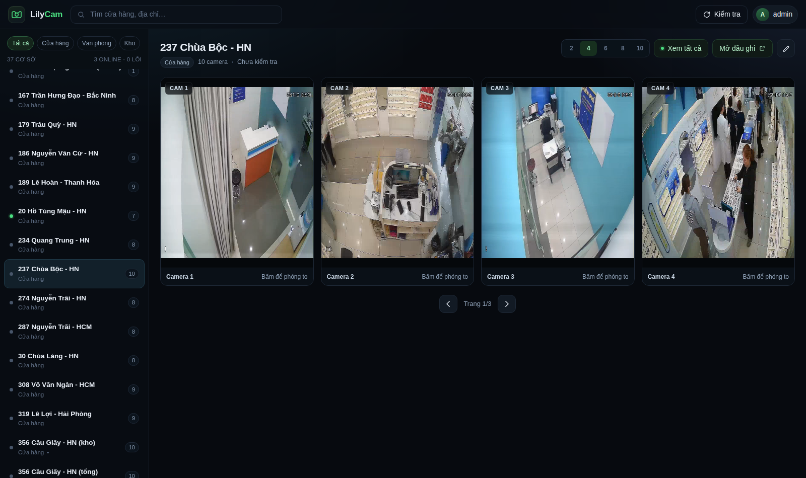
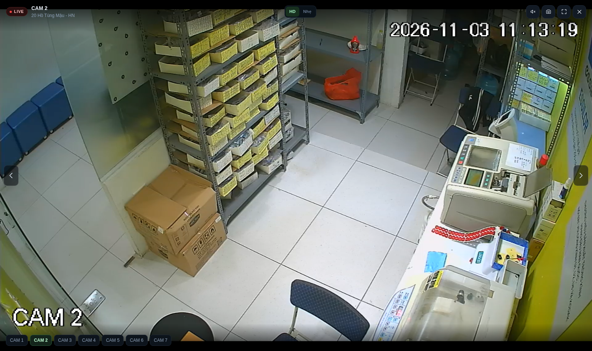
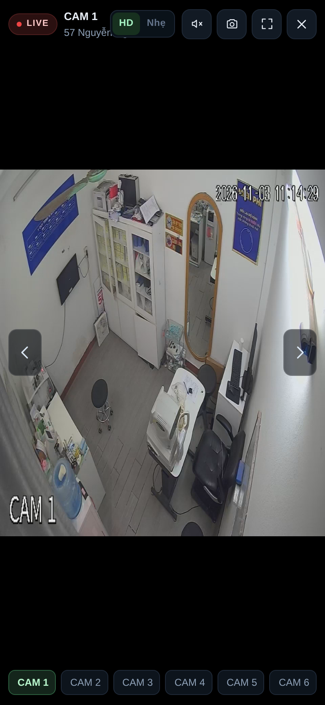
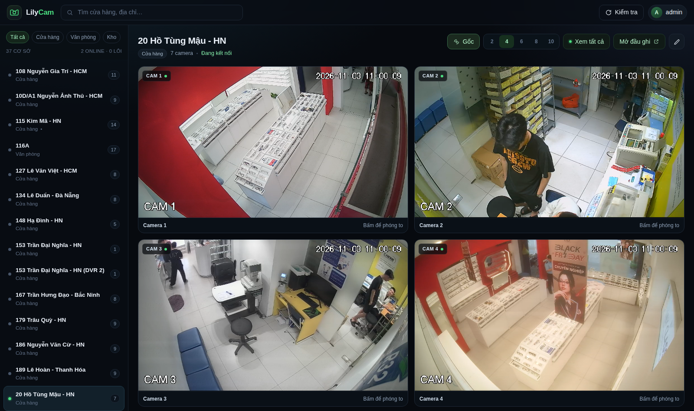
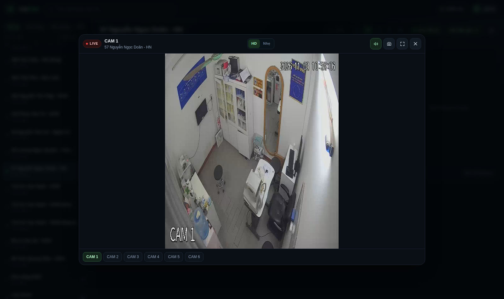
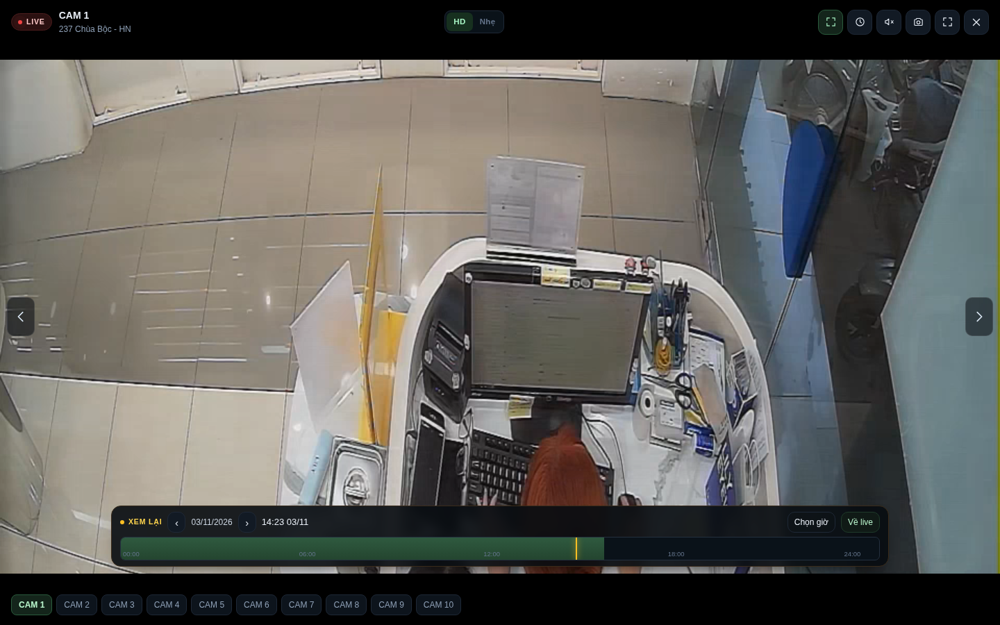

# LilyCam — web xem camera các cửa hàng

Web nội bộ, có đăng nhập, gom toàn bộ đầu ghi camera của chuỗi (37 cơ sở, dữ liệu lấy từ
Lark Base **“List camera Lily”**) vào một chỗ: chọn cửa hàng → thấy lưới camera → bấm 1 ô là
xem **trực tiếp** ngay trong lưới (không cần bấm), chọn **2 / 4 / 6 / 8 / 10 camera** một lúc,
có **chế độ phóng to HD 1080p**. Không cần SmartPSS, không cần plugin ActiveX.



| Lưới 2 camera | Lưới 10 camera |
|---|---|
|  |  |

| Camera dọc (4 ô) | Phóng to HD | Trên điện thoại |
|---|---|---|
|  |  |  |

---

## 1. Chạy nhanh

```bash
cd "$HOME/Camera xịn vãi "   # thư mục dự án (tên có dấu cách ở cuối)
node server.js            # http://localhost:8790
```

Hoặc chạy nền:

```bash
./start.sh                # ghi log vào server.log
```

Mở `http://localhost:8790` (trong LAN: `http://<IP-máy-chạy>:8790`).

Tài khoản mặc định: **admin** — mật khẩu in ra ở lần chạy đầu tiên (lưu dạng hash scrypt
trong `data/users.json`, không lưu plaintext).

Quên mật khẩu: `node server.js --reset-password`. Đổi cổng: `PORT=9000 node server.js`.

---

## 2. Lưới camera trực tiếp

- Chọn **2 / 4 / 6 / 8 / 10** ở góc phải tiêu đề cửa hàng — số cửa sổ xem cùng lúc.
  Lựa chọn được ghi nhớ cho các lần sau.
- **Tất cả ô đều chạy live** (luồng chính), không phải ảnh chụp. Ô nào đang phát có chấm xanh
  cạnh nhãn CAM.
- Cửa hàng nhiều camera hơn số ô → có **Trang 1/2, 2/2…** để xem tiếp.
- Lưới **luôn lấp đầy màn hình**: các ô đều nhau, kín chỗ, không phải cuộn lên xuống —
  chọn 2, 4, 6, 8 hay 10 đều cho một "tường camera" gọn trong một màn hình.
  Camera giữ đúng tỉ lệ (không cắt hình), nên camera dọc sẽ có viền hai bên.
- Ô nào lỗi kết nối sẽ **tự thử lại 2 lần** trước khi báo “Không có tín hiệu”.
- Camera dọc (corridor) tự đổi ô thành khung đứng cho khỏi bị viền đen.
- Bấm vào ô bất kỳ → mở **cửa sổ phát toàn màn hình** (video phủ kín cửa sổ, thanh điều khiển
  nổi bên trên), đóng lại thì lưới tự chạy tiếp.
- Mỗi ô có **nút loa riêng** ở góc phải chân ô: bật ô nào chỉ ô đó có tiếng, bật ô khác thì ô
  trước tự tắt (không bao giờ phát đồng loạt).

Băng thông mỗi ô lưới (đã thu nhỏ sẵn ở server):

| Số ô | Độ phân giải ô | fps | ~bitrate/ô | 10 ô |
|---|---|---|---|---|
| 2 | 960 px | 15 | 1,8 Mbps | — |
| 4 | 720 px | 15 | 1,1 Mbps | — |
| 6 | 640 px | 12 | 0,75 Mbps | 4,5 Mbps |
| 8 | 560 px | 12 | 0,6 Mbps | 4,8 Mbps |
| 10 | 480 px | 10 | 0,45 Mbps | 4,5 Mbps |

Đo thực tế trên i5-14400: 10 ô live cùng lúc ≈ **16–20% CPU** (khoảng 2,5 core), RAM không đáng kể.

### Luồng gốc (nút **Gốc**)

- Bỏ qua bước thu nhỏ: server **copy nguyên luồng** từ đầu ghi → CPU gần như 0,
  hình nét nhất (1920×1080), nhưng băng thông tăng ~6 lần (≈2,7 Mbps/kênh).
- Chỉ dùng được với đầu ghi **H.264**. Đầu ghi HEVC sẽ tự tắt nút này
  (trình duyệt không giải mã được HEVC).
- Nên bật khi: mạng cửa hàng khoẻ và chỉ xem 2–4 ô.



### Âm thanh

- Âm thanh G.711 của đầu ghi được chuyển sang **AAC** để trình duyệt phát được.
- **Trong lưới:** nút loa nhỏ ở chân mỗi ô — bật ô nào nghe ô đó, bật ô khác thì ô cũ tự tắt.
- **Trong cửa sổ phóng to:** nút loa ở góc phải (hoặc phím **M**).
- Camera/đầu ghi không có micro: bấm loa khoảng 3 giây sau sẽ báo “Camera này không có âm thanh”
  và tự tắt tiếng.
- Trình duyệt chặn tự phát tiếng nên luôn phải bấm nút loa một lần.



### Vừa khung / Đầy khung

- Mặc định **vừa khung**: thấy **toàn bộ** khung hình, không cắt (camera dọc sẽ có viền đen hai bên).
- Nút **⤢** ở góc phải (hoặc phím **V**) bật **đầy khung** — hình phủ kín cửa sổ nhưng **cắt bớt**
  phần thừa (camera dọc bị cắt trên/dưới). Lựa chọn được ghi nhớ.
- Camera dọc khi bật đầy khung sẽ hiện nhắc: *“Camera dọc — đang cắt trên/dưới để đầy khung.
  Bấm V để xem đủ hình.”*

### Xem lại bản ghi (playback)



- Nút **đồng hồ** ở góc phải cửa sổ xem (hoặc phím **P**) → chọn ngày/giờ hoặc bấm nhanh
  *30 phút trước / 1 giờ / 3 giờ / 8:00 hôm nay / 8:00 hôm qua*.
- Thanh **XEM LẠI** có **timeline 24 giờ**: đoạn xanh = có bản ghi, vạch vàng = vị trí đang phát.
  Bấm/kéo trên timeline để tua tới giờ cần xem; nếu rơi vào khoảng trống, web tự nhảy tới đoạn
  gần nhất và báo. Nút **‹ ›** đổi ngày, **Chọn giờ** để nhập chính xác, **Về live** trở lại.
  Dữ liệu đoạn ghi lấy qua NetSDK (`CLIENT_QueryRecordFile`), cache 5 phút.
- Kỹ thuật: server mở `rtsp://…/cam/playback?channel=N&subtype=0&starttime=…&endtime=…`
  rồi đóng gói HLS như luồng live (H.264 copy, HEVC transcode, audio AAC).

**Hai engine, tự chọn theo từng đầu ghi:**

| Engine | Dùng khi | Cách chạy |
|---|---|---|
| RTSP `/cam/playback` | đầu ghi mở playback RTSP (hiện: 20 Hồ Tùng Mậu) | ffmpeg đọc trực tiếp, mở trong ~3–6 giây |
| **Dahua NetSDK** | mọi đầu ghi còn lại | `bin/dahua-pb` tải đoạn ghi về (nhanh hơn thời gian thực), bóc header DHAV, đẩy vào ffmpeg `-re` → HLS. Mở ~8–15 giây |

- Bản ghi được tải song song với lúc phát: server đợi ~4 giây đệm rồi mới trả luồng,
  ffmpeg phát đúng 1× (`-re`) nên không bị trượt cửa sổ HLS → phát mượt, đệm luôn 3–5 giây.
  Chờ ban đầu ~5–10 giây (có ghi rõ trên màn hình).
- Cửa sổ tải tối đa **10 phút** quanh mốc đã chọn (`maxSec = 600` trong `lib/netsdk.js`); muốn xem xa hơn bấm **Chọn giờ**.
- Mỗi phiên tạm chiếm ~150–200 MB trong `data/pb`, **tự xoá** khi đóng hoặc sau 30 giây không xem.
- SDK kèm trong `sdk/` (~97 MB: `libdhnetsdk.so`, `libdhconfigsdk.so`, `libavnetsdk.so`…), helper C ở `bin/dahua-pb` (nguồn: `tools/dahua-pb.c`, build lại bằng `make -C tools`).
- ⚠️ Thư viện NetSDK lấy từ mirror công khai trên GitHub, **không phải bản phát hành chính thức từ Dahua** — nếu triển khai thương mại/cho khách hàng thì nên tải bản chính thức từ trang developer của Dahua và thay vào `sdk/lib`.

### Tốc độ mở camera

| Tình huống | Thời gian có hình |
|---|---|
| Ô lưới đang phát → bấm | **~0,1 giây** (bê nguyên video sang, không mở kết nối mới) |
| Rê chuột qua ô ≥ 0,5 giây rồi bấm | **~0,1 giây** (phiên HD đã làm nóng sẵn) |
| Bấm ngay khi ô chưa lên hình | **~0,6 giây** (ảnh MJPEG) — HD sau ~3 giây |

Cơ chế: poster lấy từ khung cuối của ô lưới, mở MJPEG ngay (không chờ dò tỉ lệ), giải phóng phiên
lưới của cửa hàng khi mở viewer, cache codec ra `data/codecs.json`, và làm nóng phiên HD khi hover.

---

## 3. Một chế độ hình: luồng chính

Trình xem **luôn mở luồng chính** (`subtype=0`) của đầu ghi — không còn nút HD/Nhẹ phải bấm.
Lưới 2/4/6/8/10 ô cũng lấy luồng chính, server thu nhỏ sẵn cho vừa ô
(960 / 720 / 640 / 640 / 560 px; 20 / 20 / 15 / 15 / 12 fps).

- HEVC → H.264 bằng ffmpeg `preset veryfast`, `crf 21–25`, thu nhỏ bằng lanczos, có B-frame
  và `aq-mode=2` (nét, ít nhiễu hơn hẳn cấu hình ultrafast cũ); đầu ghi H.264 thì copy nguyên luồng (CPU ~0).
  Băng thông tham khảo: ô 720p ~1,5–2,5 Mbps, HD 1080p ~4–6 Mbps.
- Luồng chính không mở được (mạng yếu, đầu ghi từ chối) → ô đó **tự** hiện ảnh/MJPEG rồi
  thử lại luồng chính ở lần sau, không cần bấm gì.
- Mỗi phiên = 1 tiến trình `bin/ffmpeg` (~0,2 core cho ô 720p, ~0,5–1 core cho HD 1080p).
  Tối đa **20 phiên** (`MAX_STREAMS`), **3 phiên HD** (`MAX_HD`).

### Chế độ ngủ (tiết kiệm băng thông)

- Mở web **không tự chạy camera nào**: chỉ khi bấm vào một cửa hàng thì lưới của cửa hàng đó mới mở luồng.
- Không ai xem quá **3 phút** → phiên tự "ngủ": ffmpeg tắt, kết nối RTSP tới đầu ghi đóng, thư mục tạm xoá.
  Đổi thời gian bằng biến môi trường, ví dụ `IDLE_SECS=60` (giây) trong unit systemd.
- Khi mở cửa sổ xem một camera, các phiên lưới của cùng cửa hàng được nhả ngay (`/api/release`) để
  nhường băng thông; khi đủ 20 phiên thì phiên **lâu không ai xem nhất** bị đuổi trước.
- Thay bằng ffmpeg khác: `FFMPEG=/usr/bin/ffmpeg node server.js`.

### Tỉ lệ khung hình

Ô **Tỉ lệ** ở góc dưới-trái cửa sổ xem: `Full win` (phủ kín, cắt bớt), `1:1`, `4:3`, `5:4`, `4:5`, `16:9`, `9:16`.
Chọn xong là hình ép đúng tỉ lệ đó và **ghi nhớ** cho lần sau (lưu trong trình duyệt).

### Cửa sổ xem luôn chạy luồng chính

- Mở camera là mở **luồng chính** (`/hls/hd/...`), không còn tự chuyển sang MJPEG.
- Trong lúc chờ, khung hình hiển thị là ảnh tĩnh gần nhất (không mở thêm kết nối nào tới đầu ghi).
- Luồng chính lỗi/chậm → tự **thử lại 2 lần** rồi mới tạm hạ xuống chế độ nhẹ.

### Thanh công cụ trong cửa sổ xem

| Nút | Việc |
|---|---|
| 🔍 | **Kính lúp**: bấm để phóng to 1,5× → 2× → 3× → về 1×; khi đang zoom thì **kéo chuột để di chuyển**, lăn chuột (hoặc Ctrl+lăn) để đổi mức |
| ▦ | **Vùng cảnh báo**: mở lưới ô vuông phủ lên hình, bấm/kéo để chọn vùng cần theo dõi, **Lưu vùng cảnh báo** (lưu vào `data/zones.json` theo từng camera) |
| ✛ | **PTZ**: bảng điều khiển 8 hướng + dừng + zoom ±, giữ chuột để quay liên tục, có thanh tốc độ 1–8 (gọi `/cgi-bin/ptz.cgi` của đầu ghi Dahua) |
| ⏱ | Xem lại bản ghi (chọn ngày/giờ + timeline 24 giờ) |
| 🔊 | Bật/tắt tiếng |
| 📷 | **Chụp ảnh** → mở hộp thoại ghi lỗi: khoanh vùng lỗi trên ảnh (chữ nhật/elip, hoàn tác được), chọn **DANH MỤC SỰ CỐ**, **HẠNG MỤC 5S**, viết **MÔ TẢ SỰ CỐ** → bấm **Gửi vào Giám sát tháng** là ghi luôn một dòng mới lên Lark (tuần tự tính theo ngày chụp, ảnh đã khoanh vùng được đính kèm), rồi mở tab cửa hàng |
| ✕ | Đóng |

**Nhấp đúp chuột trái** vào cửa sổ cam = phóng to / thu nhỏ toàn màn hình.
Phím tắt: `Z` kính lúp · `P` xem lại · `M` tiếng · `C` chụp ảnh · `S` lưu ảnh ·
`F` toàn màn hình · `←/→` đổi camera · `Esc` đóng.

### Cấu hình nút Chụp ảnh (Lark "Giám sát tháng")

`data/lark.json` giữ base/table/bảng trường; ảnh lưu ở `data/captures/YYYY-MM-DD/`.
Việc ghi lên Lark dùng `bin/lark-cli` với tài khoản người dùng, nên cần cấp quyền **một lần**:

```bash
bin/lark-cli auth login --scope "bitable:app base:record:create base:field:read drive:drive"
```

Cấp xong, mỗi lần bấm 📷 là một dòng mới xuất hiện trong bảng *Giám sát tháng* (kèm ảnh,
tuần tự chọn theo ngày chụp, và **CƠ SỞ** gán theo nhóm chat của cửa hàng trong `data/dm.ndjson`).

Sau khi tạo dòng, web **mở thẳng tab (view) của đúng cửa hàng** để gõ danh mục lỗi/mô tả ngay trên bảng
(không mở hộp chi tiết bản ghi). Bản đồ cơ sở → tab nằm ở `data/lark-views.json`;
thêm/đổi tab bên Lark thì chạy lại:

```bash
node tools/lark-views.js     # 35/37 cơ sở khớp tab; còn lại rơi về tab "Tổng hợp"
```

Muốn mở chi tiết bản ghi thay vì bảng thì đặt `"open": "record"` trong `data/lark.json`.

Vài cơ sở chưa có nhóm chat trong bảng danh mục (`Lily Home`, `116A`, `Kho tổng HCM`, …) nên trường
**CƠ SỞ** của dòng mới sẽ để trống — chọn tay trong Lark. Ảnh vẫn được lưu ở `data/captures/`
nên không mất dữ liệu kể cả khi Lark lỗi.

---

## 4. Cách hoạt động tổng thể

```
Trình duyệt ──► LilyCam (Node) ──HTTP Digest──► Ảnh JPEG (lưới camera)
     │                │
     │                └──RTSP───────────────► ffmpeg ──► HLS (xem HD)
     └── chỉ nhận ảnh / video, không thấy IP – tài khoản – mật khẩu camera
```

Server giữ toàn bộ thông tin đăng nhập camera; trình duyệt chỉ thấy `/api/snap`,
`/api/stream`, `/hls/...`.

Mỗi ô lưới là một phiên HLS riêng (`/hls/g4/...`, `g6`, `g10`…) do server thu nhỏ sẵn;
ô phóng to dùng `/hls/hd/...` giữ nguyên độ phân giải. Lưới **8–10 ô lấy luồng phụ**
(`subtype=1`) của đầu ghi — ô chỉ ~300 px nên không cần 1080p, đổi lại CPU server giảm ~3 lần
và đầu ghi không bị nghẽn upload; đầu ghi nào không có luồng phụ thì tự quay về luồng chính.
Tối đa 20 phiên cùng lúc, tối đa 3 phiên HD; phiên không ai xem tự tắt sau 3 phút (`IDLE_SECS`).

---

## 5. Bảo mật

| Hạng mục | Cách làm |
|---|---|
| Đăng nhập | 1 tài khoản `admin`, mật khẩu hash **scrypt** (N=16384), so sánh timing-safe |
| Phiên | Cookie `HttpOnly; SameSite=Lax`, ký **HMAC-SHA256**, hết hạn sau 12 giờ |
| Chống dò | 10 lần / 10 phút mỗi IP, 8 lần / 10 phút mỗi tài khoản + delay 350 ms |
| Header | CSP chặt (kể cả `worker-src blob:` cho hls.js), `X-Frame-Options: DENY`, `nosniff` |
| Dữ liệu | Mật khẩu camera chỉ ở `data/cameras.json` (quyền 600) trên máy chủ |
| API | Mọi endpoint (trừ `/api/login`, `/api/health`) đều cần phiên hợp lệ |

**Nên làm thêm:**

1. Đổi mật khẩu ngay sau lần đăng nhập đầu (menu góc phải → Đổi mật khẩu).
2. Không mở cổng 8790 ra Internet trực tiếp. Xem từ xa: dùng **Tailscale**
   (`tailscale up` trên máy chạy web, điện thoại cài Tailscale → mở `http://<tailscale-ip>:8790`)
   hoặc **Cloudflare Tunnel** có Access/OTP.
3. Nếu buộc phải qua Internet: đặt sau reverse proxy HTTPS (Caddy/Nginx) và gửi header
   `X-Forwarded-Proto: https` để cookie có cờ `Secure`.
4. `chmod 600 data/*.json data/.session-secret`.

---

## 6. Cập nhật danh sách từ Lark

Dữ liệu nằm ở `data/cameras.json`. Khi bảng Lark thay đổi:

```bash
node sync-lark.js         # dùng lark-cli đã đăng nhập trên máy này
```

Script chỉ cập nhật tên / đơn vị / số camera / gói cước / SN / hợp đồng và **giữ nguyên**
host – cổng – mật khẩu đang dùng (đã kiểm tra thực tế), trừ cơ sở mới.

Sửa tay: chọn cơ sở → nút **bút chì** → sửa địa chỉ / cổng / tài khoản / mật khẩu / số camera.

Cấu hình nguồn: `data/source.json`.

---

## 7. Cấu trúc

```
Camera xịn vãi /
├── server.js           # HTTP server + API + phân quyền (không npm dependency)
├── lib/dahua.js        # client HTTP Digest cho đầu ghi Dahua
├── lib/hls.js          # quản lý phiên ffmpeg → HLS (HD)
├── lib/jpeg.js         # đọc kích thước khung hình JPEG
├── bin/ffmpeg          # ffmpeg static (kèm sẵn)
├── public/
│   ├── index.html, styles.css, app.js
│   └── vendor/hls.light.min.js
├── data/
│   ├── cameras.json    # 37 cơ sở: host, cổng, user, pass, số camera (đã dò thực tế)
│   ├── users.json, source.json, .session-secret
│   └── hls/            # thư mục tạm của ffmpeg (tự dọn)
├── sync-lark.js
└── start.sh
```

Yêu cầu: Node.js ≥ 18, Linux x86_64 (cho `bin/ffmpeg`). Không cần `npm install`.

---

## 8. Đo hiệu năng & theo dõi

```bash
python3 tools/bench.py --port 8790 --hd 8 --token "$TOKEN"   # đo DNS/TCP/snapshot/HD
curl -s -H "Cookie: lilycam_sid=$TOKEN" localhost:8790/api/stats   # phiên đang chạy, RAM
./tools/restart.sh                                            # khởi động lại chắc chắn (chờ cổng trống)
```

Báo cáo mới nhất: [docs/bao-cao-hieu-nang.md](docs/bao-cao-hieu-nang.md) · dữ liệu thô: `docs/bench.json`.

## 9. Xử lý sự cố

| Hiện tượng | Nguyên nhân / cách xử lý |
|---|---|
| Ô camera “Không có tín hiệu”, banner đỏ | Đầu ghi mất mạng, DDNS sai, cổng forward đóng. Bấm **Thử lại** hoặc sửa bằng nút bút chì |
| HD cứ tự về “Nhẹ” | Đầu ghi không mở RTSP 554, mạng yếu, hoặc trình duyệt không có H.264 (Chromium thuần). Dùng Chrome/Edge/Safari |
| Lần đầu mở HD chậm 4–6 giây | ffmpeg phải dò codec + chờ keyframe; các lần sau nhanh hơn |
| Máy nóng / CPU cao | Giảm `MAX_STREAMS` / `MAX_HD`, chọn lưới ít ô hơn, hoặc dùng chế độ Nhẹ |
| Lưới 10 ô bị giật | Băng thông upload của cửa hàng không đủ 10 luồng — chọn 4 hoặc 6 ô |
| Ảnh có giờ lệch | Giờ do đầu ghi đóng dấu (OSD), không phải của web — cần chỉnh đồng hồ trên đầu ghi |
| Quên mật khẩu | `node server.js --reset-password` |

---

## Quy tắc khi chụp ảnh gửi Giám sát tháng (cập nhật 05/11/2026)

1. Bấm **📷** → hộp thoại hiện ảnh đang xem, có 3 công cụ đánh dấu:
   - **▭ Khoanh vùng**, **◯ Khoanh tròn**, **➜ Mũi tên chỉ lỗi** (kéo từ điểm bắt đầu tới đúng chỗ vi phạm),
   - **↶ Hoàn tác** / **Xoá hết**; ảnh gửi lên là ảnh đã đánh dấu.
2. **DANH MỤC SỰ CỐ** để trống cho bạn tự chọn — có 2 nút chọn nhanh **Lỗi 5S** / **Lỗi 4C**.
3. Tự động điền theo danh mục:

   | Danh mục | NGƯỜI CHỊU TRÁCH NHIỆM | NHẬN XÉT CỦA GIÁM SÁT VIÊN |
   |---|---|---|
   | VỆ SINH 5S / 4C | tự gắn **cửa hàng trưởng (CHT)** của cơ sở | để trống |
   | Lỗi khác | để trống | “Trưởng bộ phận note tên người chịu trách nhiệm” |

4. **Không** tự tích “Đã gửi sự cố” và không tự bấm nút “Gửi sự cố” — người dùng tự làm để automation
   định tuyến tới GSV duyệt.

Dữ liệu CHT lấy từ `data/stores.json` (danh mục cơ sở của công cụ 5S, 35/35 cơ sở có `cht_id`);
`data/dm.ndjson` chỉ còn là nguồn dự phòng (26/37 cơ sở).


---

## Cấu trúc kho mã (cập nhật 05/11/2026)

- `rust/` — mã nguồn server hiện tại (Rust, axum + tokio), đóng gói qua `Dockerfile`.
- `public/` — giao diện web.
- `data/` — dữ liệu thật (không đưa lên git): cameras, users, zones, captures…
- `legacy/` — **bản Node.js cũ**, chỉ để tham chiếu, không dùng để chạy.
- `tools/` — script phụ: `backup.sh`, `dahua-pb.c`, `bench*`.
